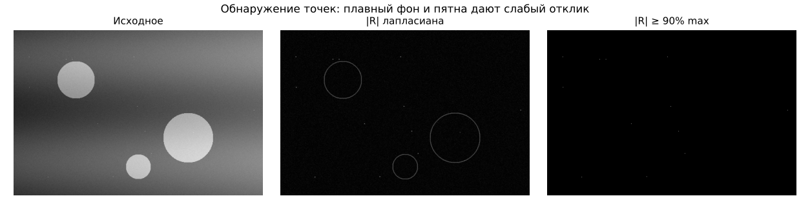
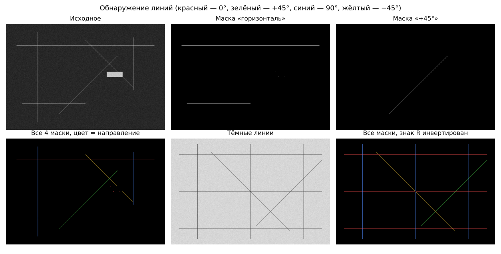
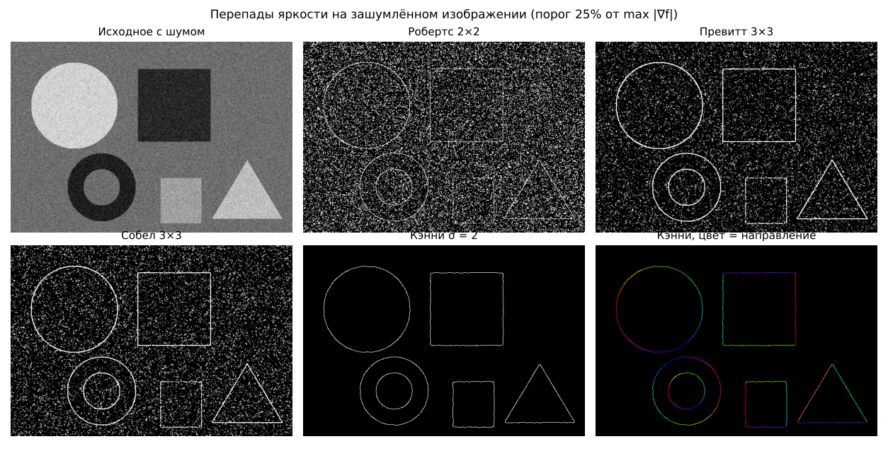
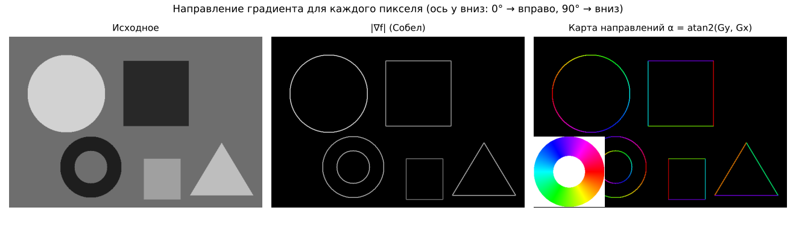
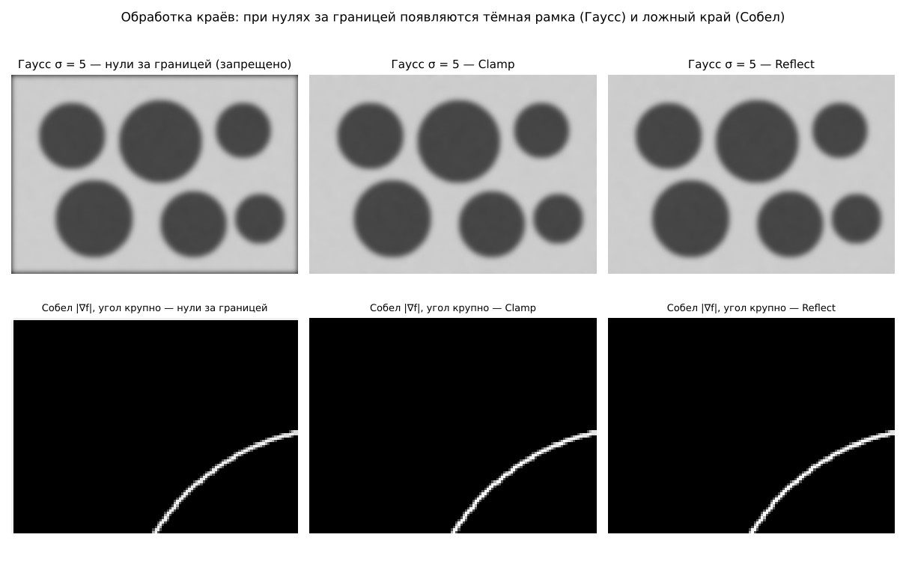

# Лабораторная работа 3 — пороговая обработка и сегментация изображений

**Вариант 9:** глобальная пороговая обработка (2 метода) + адаптивная пороговая обработка;
сегментация — обнаружение точек, линий и перепадов яркости. Выполнено с дополнениями для группы 10А.

## Запуск

```bash
./gradlew :lab3-image-processing:run
./gradlew :lab3-image-processing:test
```

Windows-установщик `ImageProcessing.exe` собирает GitHub Actions (workflow **Build Windows EXE**).
Тестовые изображения встроены в программу — список «Тестовые изображения» в верхней панели.

## Что реализовано

| Раздел | Методы |
|---|---|
| Глобальный порог | итеративный (среднее двух средних), **метод Оцу** (максимум межклассовой дисперсии) |
| Адаптивный порог | среднее окна − C, метод Сауволы; оба через **интегральное изображение** (O(1) на пиксель) |
| Точки | маска лапласиана 3×3, порог в % от max \|R\| |
| Линии | 4 маски 3×3 (0°, +45°, 90°, −45°), режим «все направления» с раскраской |
| Перепады | Робертс 2×2, Превитт 3×3, Собел 3×3; модуль, края по порогу, **карта направлений** |
| Кэнни | разделяемый Гаусс, Собел, подавление немаксимумов с **интерполяцией**, гистерезис |
| Края изображения | **Clamp** и **Reflect** на выбор для всех свёрток и окон |
| Скорость | ручной доступ к массиву, **многопоточная свёртка** по полосам строк, число потоков задаётся |

## Архитектура

| Слой | Пакет / классы | Ответственность |
|---|---|---|
| Presentation (UI) | `ui.ControlsPane`, `ui.HistogramView`, `ui.HueLegend`, `MainApp` | картинки «до» и «после», гистограммы, слайдеры параметров, прогресс; обработка в фоновом потоке |
| Memory & Pixel Access | `buffer.GrayImage`, `buffer.ColorImage`, `buffer.EdgeMode`, `buffer.FxImages`, `buffer.BmpWriter` | изображение как одномерный массив `int[]`; доступ `get(x, y, EdgeMode)` с обработкой краёв; обмен с JavaFX одним блоком |
| Processing | `processing.*` | чистые функции «буфер → новый буфер», ничего не знают об интерфейсе |

**Доступ к пикселям.** Картинка один раз копируется из JavaFX `Image` в массив целиком
(`PixelReader.getPixels` — аналог `LockBits`) и обратно (`PixelWriter.setPixels`). Все алгоритмы —
вложенные циклы по массиву `data[y * width + x]`; поштучных `getArgb`/`setArgb` нет.
Перевод в оттенки серого: Y = 0,299R + 0,587G + 0,114B.

**Обработка краёв** (`EdgeMode.index`):

- **Clamp** — индекс за границей заменяется ближайшим граничным: `… a a | a b c | c c …`;
- **Reflect** — зеркально без повтора граничного: `… c b | a b c | b a …`.

Свёртка внутри изображения идёт без проверок, а у краёв — через `EdgeMode`, поэтому края
не обрезаются и не заливаются чёрным.

**Многопоточность** (`processing.Parallel`): строки делятся на полосы (до 4 на поток),
потоки забирают полосы из общего счётчика. Каждый пиксель результата пишет ровно один поток,
поэтому синхронизация не нужна.

## Методы

### Итеративный глобальный порог

1. T₀ — средняя яркость изображения.
2. G₁ — пиксели > T, G₂ — пиксели ≤ T; m₁, m₂ — их средние.
3. T = (m₁ + m₂) / 2; повторять, пока |ΔT| ≥ 0,5.

Считается по гистограмме, а не по пикселям, поэтому одна итерация — 256 операций.
Метод сходится к ближайшей «долине» гистограммы от начального среднего.

### Метод Оцу

По нормированной гистограмме pᵢ для каждого k = 0…255:

- ω(k) = Σᵢ₌₀ᵏ pᵢ — доля пикселей класса «≤ k»;
- μ(k) = Σᵢ₌₀ᵏ i·pᵢ, μ_T = μ(255);
- межклассовая дисперсия **σ²_B(k) = (μ_T·ω(k) − μ(k))² / (ω(k)·(1 − ω(k)))**.

Порог — k с максимальной σ²_B (если максимумов несколько — среднее их k).
Выводится также показатель разделимости η = σ²_B / σ²_G ∈ [0, 1].

**Итеративный и Оцу.** Условие оптимальности Оцу тоже даёт T = (m₁ + m₂)/2, то есть итеративный метод
находит *локальный* экстремум того же критерия, а Оцу перебором — *глобальный*. На гистограмме с двумя пиками
они совпадают, с тремя — могут выбрать разные долины (рисунки 2 и 3).

### Адаптивный порог

**Интегральное изображение** S(x, y) — сумма всех пикселей выше-левее (x, y). Строится за один проход
по изображению, дополненному на r пикселей с выбранной обработкой краёв. Сумма в любом окне — четыре
обращения: **S(D) − S(B) − S(C) + S(A)**, то есть O(1) на пиксель при любом размере окна.
Второе интегральное изображение — для сумм квадратов.

- **Среднее − C:** T(x, y) = m(x, y) − C. Медленно меняющееся освещение входит в среднее m и вычитается.
- **Саувола:** T(x, y) = m · (1 + k·(s/R − 1)), R = 128; s = √(E[f²] − m²) — СКО в окне.
  В однородной области s мало, порог ниже среднего — фон не превращается в шум.

### Обнаружение точек

Маска лапласиана: 8 в центре, −1 вокруг (сумма весов 0). На ровном фоне и линейном градиенте R = 0,
на одиночной точке |R| максимален. Точка — |R| ≥ T, T = p% · max |R|.

### Обнаружение линий

```
 горизонталь      +45°           вертикаль       −45°
 -1 -1 -1       -1 -1  2        -1  2 -1        2 -1 -1
  2  2  2       -1  2 -1        -1  2 -1       -1  2 -1
 -1 -1 -1        2 -1 -1        -1  2 -1       -1 -1  2
```

Отклик максимален на линии толщиной 1 пиксель «своего» направления. В режиме «все направления» каждый
пиксель относится к маске с наибольшим R (цвет: красный 0°, зелёный +45°, синий 90°, жёлтый −45°).
Для тёмных линий на светлом фоне знак R меняется.

### Перепады яркости

| Оператор | Gx | Gy |
|---|---|---|
| Робертс 2×2 | по диагоналям: g₁ = f(x+1, y+1) − f(x, y), g₂ = f(x, y+1) − f(x+1, y); Gx = (g₁ − g₂)/2, Gy = (g₁ + g₂)/2 | |
| Превитт 3×3 | `[-1 0 1]` в трёх строках | `[-1 -1 -1; 0 0 0; 1 1 1]` |
| Собел 3×3 | `[-1 0 1; -2 0 2; -1 0 1]` | `[-1 -2 -1; 0 0 0; 1 2 1]` |

Модуль |∇f| = √(Gx² + Gy²). **Угол для каждого пикселя α = atan2(Gy, Gx)** (ось y вниз:
0° — яркость растёт вправо, 90° — вниз). Карта направлений: оттенок HSV = α, яркость = √(|∇f| / max).
Опционально — предварительное сглаживание разделяемым Гауссом.

### Детектор Кэнни

1. **Гаусс через разделяемую свёртку:** ядро G(x, y) = g(x)·g(y), поэтому двумерная свёртка заменяется
   двумя одномерными — по строкам, затем по столбцам. Сложность O(K·N²) вместо O(K²·N²). Радиус ядра ⌈3σ⌉.
2. Градиент Собела: модуль и угол.
3. **Подавление немаксимумов с интерполяцией:** модуль в пикселе p сравнивается со значениями в дробных
   точках p ± (cos α, sin α), найденных билинейной интерполяцией. Направление учитывается точно, а не
   округляется до 4 секторов.
4. **Двойной порог и гистерезис:** |∇f| ≥ T_high — сильные края; T_low ≤ |∇f| < T_high — слабые,
   остаются, если 8-связно соединены с сильными (обход стеком).

## Тестовые изображения

Встроены в программу (`src/main/resources/by/bsu/imageproc/samples`), генератор — `docs/make_samples.py`.

| № | Изображение | Что показывает |
|---|---|---|
| 1 | Монеты на светлом фоне | два пика гистограммы — оба глобальных метода работают |
| 2 | Текст на бумаге двух оттенков | **Оцу лучше:** итеративный делит лист пополам |
| 3 | Деталь с наклейками на тёмном столе | **итеративный лучше:** Оцу выделяет только наклейки |
| 4 | Текст при неравномерном освещении | **только адаптивный** даёт приемлемый результат |
| 5 | Документ с тенью | **только адаптивный** |
| 6 | Одиночные точки на неоднородном фоне | обнаружение точек |
| 7 | Светлые линии четырёх направлений | обнаружение линий по маскам |
| 8 | Тёмные линии на светлом фоне | линии с инверсией знака |
| 9 | Геометрические фигуры | перепады, карта направлений |
| 10 | Фигуры с шумом | сравнение Робертса, Превитта, Собела и Кэнни |
| 11 | 4000 × 3000 | скорость, многопоточность |

## Отчёт: сравнение «до» и «после»

### 1. Два пика — оба глобальных метода работают


Пики классов разделены широкой «долиной», итеративный (137) и Оцу (135) попадают в неё,
η = 0,97 — классы разделимы почти идеально. После пороговой обработки гистограмма — два значения.

### 2. Оцу лучше итеративного


Три пика: текст (45), затенённая (190) и светлая (245) части листа. Средняя яркость ≈ 207 лежит
между оттенками бумаги, и итеративный метод сходится к T = 205 — делит лист пополам (55% чёрного).
Оцу перебирает все пороги: разбиение «текст | бумага» даёт σ²_B больше, чем «тень | свет», T = 115,
чёрного 9% — только текст.

### 3. Итеративный лучше Оцу


Задача — отделить серую деталь (92) от тёмного стола (14); на детали яркие наклейки (194).
Среднее ≈ 69 ближе к долине «стол | деталь», итеративный находит T = 65. У Оцу глобальный максимум
σ²_B — на разбиении «наклейки | всё остальное» (T = 140), деталь теряется.

### 4–5. Адаптивный порог


На гистограмме до обработки нет «долины» между текстом и фоном: фон сам меняется от 60 до 240.
Любой глобальный порог заливает тёмную часть чёрным. Адаптивный порог сравнивает пиксель со средним
в его окне: доля чёрного после обработки ≈ 9–10% — это и есть текст.

### 6. Точки



Отклик лапласиана на плавном градиенте ≈ 0, на краях пятен — умеренный, на одиночных пикселях —
максимальный. Порог 90% от max |R| оставляет только точки.

### 7. Линии



Каждая маска выделяет линии своего направления. Широкий прямоугольник почти не даёт отклика:
маска реагирует на ширину 1 пиксель, внутри широкой области центральная строка и соседние гасят друг друга.

### 8. Перепады на зашумлённом изображении



Робертс (2×2) использует две точки — на шуме много ложных краёв. Превитт и Собел (3×3) усредняют
по трём строкам, шум слабее. Кэнни после сглаживания Гауссом даёт тонкие непрерывные контуры
толщиной 1 пиксель.

### 9. Карта направлений



Круг содержит все направления границы — по его контуру проходит весь круг оттенков. У тёмного квадрата
градиент направлен наружу, у светлых фигур — внутрь.

### 10. Обработка краёв изображения



Если считать пиксели за границей нулями, сглаживание даёт тёмную рамку, а градиент — ложный край по периметру.
Clamp и Reflect продолжают изображение его собственными значениями, артефактов нет.

### 11. Быстродействие

Изображение 4000 × 3000 (12 млн пикселей), машина с 2 ядрами, лучшее из 3 запусков:

| Операция | 1 поток | 2 потока |
|---|---|---|
| Кэнни (σ = 2) | 1604 мс | 1048 мс |
| Собел, модуль градиента | 710 мс | 533 мс |
| Саувола, окно 51×51 | 318 мс | 204 мс |
| Гаусс σ = 5 (ядро 31), разделяемый | 1064 мс | 534 мс |

Разделяемая свёртка против полной двумерной (2 потока):

| Ядро Гаусса | Две 1D-свёртки | Одна 2D-свёртка | Выигрыш |
|---|---|---|---|
| 7 × 7 | 132 мс | 244 мс | 1,8× |
| 19 × 19 | 265 мс | 1247 мс | 4,7× |
| 31 × 31 | 498 мс | 3186 мс | 6,4× |

Адаптивный порог Сауволы через интегральное изображение не зависит от размера окна:
11×11 — 179 мс, 51×51 — 183 мс, 151×151 — 193 мс.

## Соответствие дополнениям для группы 10А

| Требование | Где |
|---|---|
| Пиксельный доступ без GetPixel/SetPixel | `buffer.FxImages` (блочное копирование), все алгоритмы — циклы по `int[]` / `double[]` |
| Обработка краёв Clamp и Reflect | `buffer.EdgeMode`, выбор в интерфейсе |
| Разделяемая свёртка | `Convolution.separable`, используется в Кэнни и сглаживании перед градиентом |
| Честный угол градиента и карта направлений | `EdgeDetector.gradient`, `DirectionColors` |
| Оцу с межклассовой дисперсией | `GlobalThreshold.otsu` |
| Интегральное изображение для адаптивного порога | `IntegralImage`, `AdaptiveThreshold` |
| Кэнни с интерполяцией при подавлении немаксимумов | `Canny.nonMaximumSuppression` |
| Многопоточная свёртка | `Parallel.rows` |
| Отчёт с гистограммами до/после | этот файл, раздел «Отчёт» |
| Слои UI / Memory / Processing | пакеты `ui`, `buffer`, `processing` |
