# Лабораторная работа 3 — пороговая обработка и нелинейные фильтры

**Вариант 10:** глобальная пороговая обработка (2 метода) + адаптивная пороговая обработка;
нелинейные фильтры, основанные на порядковых статистиках. Выполнено с дополнениями для группы 10А.

## Запуск

```bash
./gradlew :lab3-image-processing:run
./gradlew :lab3-image-processing:test
```

Windows-установщик `ImageProcessing.exe` собирает GitHub Actions (workflow **Build Windows EXE**).
Тестовые изображения встроены в программу — список «Тестовые изображения» в верхней панели.
К любому изображению можно добавить шум (панель «Шум»); если есть изображение без шума, программа
показывает PSNR до и после обработки.

## Что реализовано

| Раздел | Методы |
|---|---|
| Глобальный порог | итеративный (среднее двух средних), **метод Оцу** (максимум межклассовой дисперсии) |
| Адаптивный порог | среднее окна − C, метод Сауволы; оба через **интегральное изображение** (O(1) на пиксель) |
| Порядковые фильтры | медиана, минимум, максимум, средняя точка, усечённое среднее (α-trimmed), произвольный процентиль |
| Адаптивная медиана | окно растёт от 3×3 до Smax только там, где медиана — импульс |
| Форма окна | квадрат, крест, круг; радиус 1–15 |
| Быстрый алгоритм | **алгоритм Хуанга** со скользящей гистограммой окна: O(r) на пиксель вместо O(r² log r) |
| Морфология | эрозия, дилатация, открытие, закрытие, **морфологический градиент, Top-Hat, Black-Hat** |
| Для сравнения | усредняющий фильтр и Гаусс через **разделяемую свёртку**; полная 2D-свёртка |
| Связка | медиана перед порогом; бинаризация по Оцу после любого фильтра |
| Шум и качество | соль-перец, соль, перец, гауссов, равномерный, смешанный; MSE и PSNR |
| Края изображения | **Clamp** и **Reflect** на выбор для всех окон и свёрток |
| Скорость | ручной доступ к массиву, **многопоточная обработка** по полосам строк, число потоков задаётся |

## Архитектура

| Слой | Пакет / классы | Ответственность |
|---|---|---|
| Presentation (UI) | `ui.ControlsPane`, `ui.HistogramView`, `MainApp` | картинки «до» и «после», гистограммы, слайдеры, прогресс; обработка в фоновом потоке |
| Memory & Pixel Access | `buffer.GrayImage`, `buffer.ColorImage`, `buffer.EdgeMode`, `buffer.FxImages`, `buffer.BmpWriter` | изображение как одномерный массив `int[]`; доступ `get(x, y, EdgeMode)` с обработкой краёв; обмен с JavaFX одним блоком |
| Processing | `processing.*` | чистые функции «буфер → новый буфер», ничего не знают об интерфейсе |

Классы слоя Processing:

| Класс | Что делает |
|---|---|
| `Histogram`, `GlobalThreshold` | гистограмма, итеративный порог, Оцу, бинаризация |
| `IntegralImage`, `AdaptiveThreshold` | интегральные изображения сумм и квадратов, «среднее − C», Саувола |
| `WindowShape` | форма окна: для каждой строки окна — отрезок [from, to] |
| `Statistic` | какую порядковую статистику брать: медиана, min, max, средняя точка, усечённое среднее, процентиль |
| `OrderFilter` | `naive` — сортировка окна, `huang` — скользящая гистограмма |
| `AdaptiveMedian` | адаптивный медианный фильтр |
| `Morphology` | эрозия = min, дилатация = max и их комбинации |
| `Convolution`, `Kernel`, `RealImage`, `LinearFilter` | линейные фильтры для сравнения |
| `Noise`, `Quality` | генератор шума, MSE, PSNR, растяжение контраста |
| `Parallel`, `Progress` | пул потоков, полосы строк, прогресс и отмена |

**Доступ к пикселям.** Картинка один раз копируется из JavaFX `Image` в массив целиком
(`PixelReader.getPixels` — аналог `LockBits`) и обратно (`PixelWriter.setPixels`). Все алгоритмы —
вложенные циклы по массиву `data[y * width + x]`; поштучных `getArgb`/`setArgb` нет.
Перевод в оттенки серого: Y = 0,299R + 0,587G + 0,114B.

**Обработка краёв** (`EdgeMode.index`):

- **Clamp** — индекс за границей заменяется ближайшим граничным: `… a a | a b c | c c …`;
- **Reflect** — зеркально без повтора граничного: `… c b | a b c | b a …`.

Для порядковых фильтров заранее строится таблица индексов столбцов с полями по r пикселей,
поэтому во внутреннем цикле проверок границ нет, а число элементов окна у края то же, что и в центре.

**Многопоточность** (`processing.Parallel`): строки делятся на полосы (до 4 на поток),
потоки забирают полосы из общего счётчика. Каждый пиксель результата пишет ровно один поток,
у каждого потока своя гистограмма окна, поэтому синхронизация не нужна.

## Пороговая обработка

### Итеративный глобальный порог

1. T₀ — средняя яркость изображения.
2. G₁ — пиксели > T, G₂ — пиксели ≤ T; m₁, m₂ — их средние.
3. T = (m₁ + m₂) / 2; повторять, пока |ΔT| ≥ 0,5.

Считается по гистограмме, а не по пикселям, поэтому одна итерация — 256 операций.
Метод сходится к ближайшей «долине» гистограммы от начального среднего.

### Метод Оцу

По нормированной гистограмме pᵢ для каждого k = 0…255:

- ω(k) = Σᵢ₌₀ᵏ pᵢ — доля пикселей класса «≤ k»;
- μ(k) = Σᵢ₌₀ᵏ i·pᵢ, μ_T = μ(255);
- межклассовая дисперсия **σ²_B(k) = (μ_T·ω(k) − μ(k))² / (ω(k)·(1 − ω(k)))** — то же, что ω₀ω₁(μ₀ − μ₁)².

Порог — k с максимальной σ²_B. Выводится также показатель разделимости η = σ²_B / σ²_G ∈ [0, 1].

Условие оптимальности Оцу тоже даёт T = (m₁ + m₂)/2, то есть итеративный метод находит *локальный*
экстремум того же критерия, а Оцу перебором — *глобальный*. На гистограмме с двумя пиками они совпадают,
с тремя — могут выбрать разные долины (рисунки 2 и 3).

### Адаптивный порог

**Интегральное изображение** S(x, y) — сумма всех пикселей выше-левее (x, y). Строится за один проход
по изображению, дополненному на r пикселей с выбранной обработкой краёв. Сумма в любом окне — четыре
обращения: **S(D) − S(B) − S(C) + S(A)**, то есть O(1) на пиксель при любом размере окна.
Второе интегральное изображение — для сумм квадратов.

- **Среднее − C:** T(x, y) = m(x, y) − C. Медленно меняющееся освещение входит в среднее m и вычитается.
- **Саувола:** T(x, y) = m · (1 + k·(s/R − 1)), R = 128; s = √(E[f²] − m²) — СКО в окне.
  В однородной области s мало, порог ниже среднего — фон не превращается в шум.

## Нелинейные фильтры на порядковых статистиках

Значения окна W(x, y) упорядочиваются по возрастанию: g₍₀₎ ≤ g₍₁₎ ≤ … ≤ g₍ₙ₋₁₎.
Результат — функция от этого **вариационного ряда**, а не взвешенная сумма, как у линейных фильтров.

| Фильтр | Формула | Против какого шума |
|---|---|---|
| Медианный | f = g₍ₙ/₂₎ | импульсный («соль-перец») |
| Минимум | f = g₍₀₎ | белые импульсы («соль») |
| Максимум | f = g₍ₙ₋₁₎ | чёрные импульсы («перец») |
| Средняя точка | f = (g₍₀₎ + g₍ₙ₋₁₎) / 2 | равномерный, гауссов (без выбросов) |
| Усечённое среднее | f = Σᵢ₌d^(n−1−d) g₍ᵢ₎ / (n − 2d) | смешанный: гауссов + импульсный |
| Процентиль p | f = g₍ₖ₎, k = p·(n − 1) | общий вид: p = 0 — min, 50% — медиана, 100% — max |

**Почему медиана сохраняет края.** Если окно стоит на границе двух областей, в нём больше пикселей
«своей» области, и медиана берётся из неё — ступенька переносится в результат без изменений.
Импульс 0 или 255 всегда стоит в начале или в конце ряда и в середину не попадает, пока импульсов
в окне меньше половины.

### Алгоритм Хуанга (скользящая гистограмма)

Наивный способ — для каждого пикселя собрать n = (2r + 1)² значений и отсортировать: O(r² log r) на пиксель.
Яркость принимает только 256 значений, поэтому окно хранится гистограммой hist[0…255]:

1. В начале строки гистограмма заполняется всеми пикселями окна.
2. При сдвиге окна на один пиксель вправо из каждой строки окна **удаляется левый** пиксель и **добавляется
   правый**: 2·(2r + 1) операций вместо (2r + 1)².
3. Для статистики ранга k хранится текущее значение v и число элементов меньше v («below»). После обновления
   гистограммы v сдвигается вверх или вниз, пока не выполнится below ≤ k < below + hist[v]. Для гладких
   изображений это один-два шага.
4. Для усечённого среднего дополнительно хранится сумма элементов меньше v. Сумма k наименьших
   = sumBelow + (k − below)·v, поэтому сумма средней части ряда = S(n − d) − S(d) получается за O(1).

Итог — O(r) на пиксель. Форма окна (квадрат, крест, круг) задаётся отрезком [from, to] для каждой строки,
поэтому алгоритм одинаково работает для любой выпуклой формы. Результат совпадает с наивной сортировкой
бит в бит — это проверяет тест `huangEqualsNaiveSorting` для всех форм, радиусов, статистик и режимов краёв.

### Адаптивный медианный фильтр

- **Уровень A:** в окне S найти z_min, z_med, z_max. Если z_min < z_med < z_max — медиана не импульс,
  перейти к B. Иначе увеличить окно; при S > S_max выдать z_med.
- **Уровень B:** если z_min < z(x, y) < z_max — сам пиксель не импульс и **остаётся без изменений**,
  иначе заменяется на z_med.

Окно растёт только там, где плотность импульсов высокая, а неповреждённые пиксели не меняются вовсе.
Поэтому фильтр справляется с шумом 40–50%, сохраняя тонкие детали.

### Морфология

Фильтр минимума по структурирующему элементу B — это **эрозия** f ⊖ B, фильтр максимума — **дилатация** f ⊕ B.

| Операция | Формула | Что делает |
|---|---|---|
| Открытие | (f ⊖ B) ⊕ B | убирает светлые детали меньше B, фон сохраняется |
| Закрытие | (f ⊕ B) ⊖ B | убирает тёмные детали меньше B |
| Морфологический градиент | (f ⊕ B) − (f ⊖ B) | контуры объектов |
| Top-Hat | f − открытие | мелкие светлые детали на неоднородном фоне |
| Black-Hat | закрытие − f | мелкие тёмные детали на неоднородном фоне |

Открытие и закрытие идемпотентны (повторное применение ничего не меняет) — это проверяется тестом.

### Линейные фильтры для сравнения

Усредняющий фильтр и Гаусс реализованы **разделяемой свёрткой**: ядро G(x, y) = g(x)·g(y), поэтому двумерная
свёртка заменяется двумя одномерными — по строкам, затем по столбцам. O(K) вместо O(K²) на пиксель.

### Качество: PSNR

MSE = (1/N) Σ (f − f̂)², **PSNR = 10·log₁₀(255² / MSE)**, дБ. Чем больше, тем ближе результат к изображению без шума.
Для тестовых изображений 6–11 и 13 в программу встроены эталоны без шума.

## Тестовые изображения

Встроены в программу (`src/main/resources/by/bsu/imageproc/samples`), генератор — `docs/make_samples.py`.
При выборе изображения автоматически ставятся метод и параметры, над картинками появляется подсказка.

| № | Изображение | Что показывает |
|---|---|---|
| 1 | Монеты на светлом фоне | два пика гистограммы — оба глобальных метода работают |
| 2 | Текст на бумаге двух оттенков | **Оцу лучше:** итеративный делит лист пополам |
| 3 | Деталь с наклейками на тёмном столе | **итеративный лучше:** Оцу выделяет только наклейки |
| 4 | Текст при неравномерном освещении | **только адаптивный** даёт приемлемый результат |
| 5 | Документ с тенью | **только адаптивный** |
| 6 | «Соль-перец» 10% | медиана против линейного усреднения |
| 7 | «Соль-перец» 40% | обычная медиана не справляется, **адаптивная медиана** — да |
| 8 | Только белые импульсы | фильтр минимума |
| 9 | Только чёрные импульсы | фильтр максимума |
| 10 | Равномерный шум | средняя точка |
| 11 | Гауссов σ = 30 + 5% импульсов | усечённое среднее |
| 12 | Частицы на неоднородном фоне | **Top-Hat**, затем Оцу |
| 13 | Документ с импульсным шумом | **медиана перед порогом** Оцу |
| 14 | 4000 × 3000 с шумом 10% | скорость: Хуанг против наивного, многопоточность |

## Отчёт: сравнение «до» и «после»

### 1. Два пика — оба глобальных метода работают

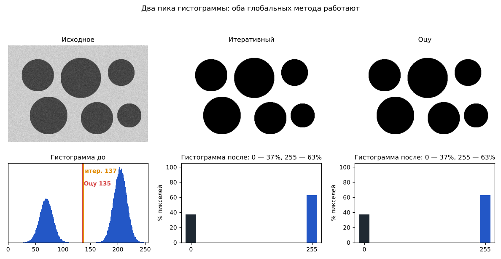

Пики классов разделены широкой «долиной», итеративный (137) и Оцу (135) попадают в неё,
η = 0,97 — классы разделимы почти идеально. После пороговой обработки гистограмма — два значения.

### 2. Оцу лучше итеративного

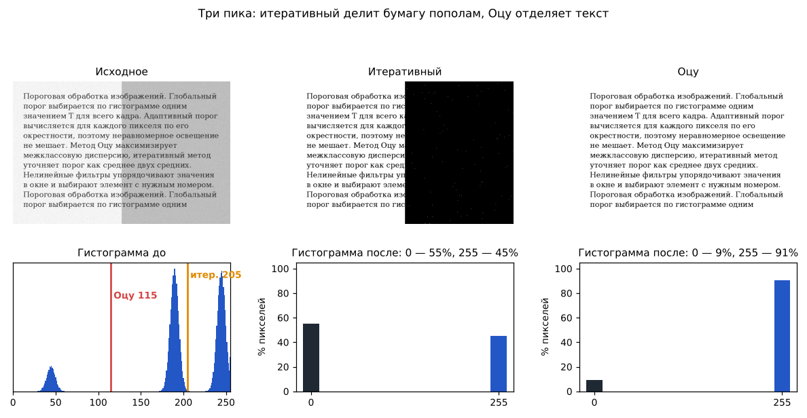

Три пика: текст (45), затенённая (190) и светлая (245) части листа. Средняя яркость ≈ 207 лежит
между оттенками бумаги, и итеративный метод сходится к T = 205 — делит лист пополам (55% чёрного).
Оцу перебирает все пороги: разбиение «текст | бумага» даёт σ²_B больше, чем «тень | свет», T = 115,
чёрного 9% — только текст.

### 3. Итеративный лучше Оцу

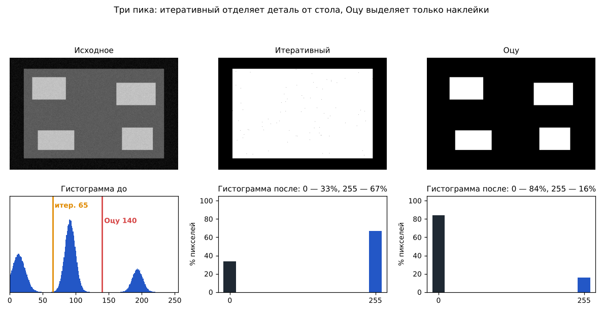

Задача — отделить серую деталь (92) от тёмного стола (14); на детали яркие наклейки (194).
Среднее ≈ 69 ближе к долине «стол | деталь», итеративный находит T = 65. У Оцу глобальный максимум
σ²_B — на разбиении «наклейки | всё остальное» (T = 140), деталь теряется.

### 4–5. Адаптивный порог

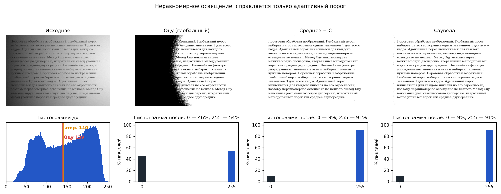
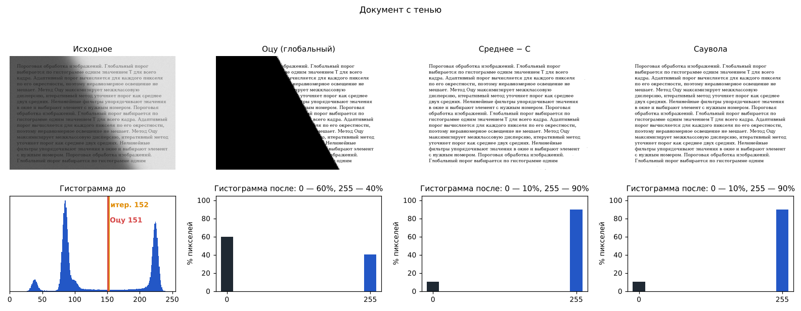

На гистограмме до обработки нет «долины» между текстом и фоном: фон сам меняется от 60 до 240.
Любой глобальный порог заливает тёмную часть чёрным (46–60% чёрного). Адаптивный порог сравнивает пиксель
со средним в его окне: доля чёрного после обработки 9–10% — это и есть текст.

### 6. Медиана против линейного усреднения

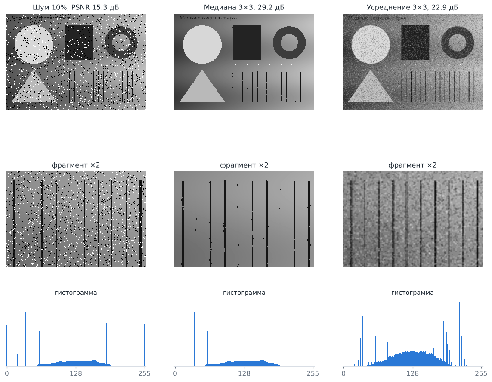

Импульсы — пики гистограммы на 0 и 255 (оранжевые, обрезаны по высоте). Медиана 3×3 убирает их полностью:
гистограмма после совпадает с гистограммой чистого изображения, края и тонкие линии резкие, PSNR 15,3 → 29,2 дБ.
Усреднение 3×3 «размазывает» каждый импульс по окну: пики исчезают, но гистограмма расплывается — появляется
серое зерно, края размыты, PSNR только 22,9 дБ.

### 7. Плотный шум: адаптивная медиана

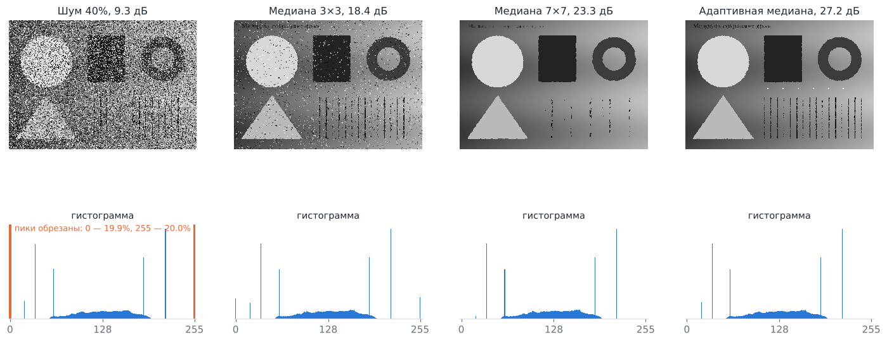

При 40% импульсов в окне 3×3 они нередко составляют половину и больше, медиана сама становится импульсом —
на гистограмме остаются пики 0 и 255 (18,4 дБ). Медиана 7×7 шум убирает, но съедает тонкие линии и точки
(23,3 дБ). Адаптивная медиана увеличивает окно только там, где нужно, и не трогает неповреждённые пиксели:
27,2 дБ, тонкие линии сохранились.

### 8. Минимум и максимум

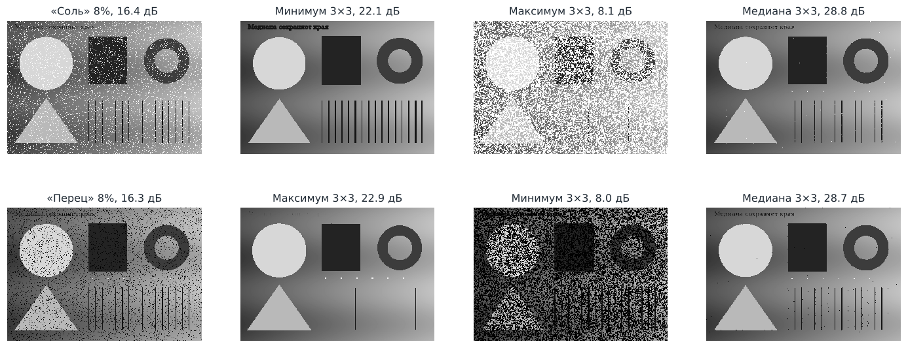

Белый импульс — максимальный элемент ряда, фильтр минимума его всегда отбрасывает; чёрный импульс — минимальный,
его отбрасывает максимум. Но минимум — это эрозия: тёмные объекты расширяются, светлые и тонкие светлые детали
сужаются, поэтому по PSNR (22 дБ) он уступает медиане (29 дБ). Применённый «не к тому» шуму фильтр раздувает
каждый импульс в квадрат 3×3 (8 дБ). Минимум и максимум — прежде всего инструменты морфологии.

### 9. Какой фильтр лучше для какого шума

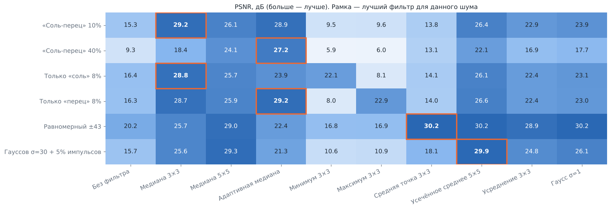

| Шум | Лучший фильтр | Почему |
|---|---|---|
| «Соль-перец» 10% | медиана 3×3 | импульсы — крайние элементы ряда |
| «Соль-перец» 40% | адаптивная медиана | окно растёт там, где медиана — импульс |
| Только «соль» / «перец» | медиана, адаптивная медиана | min/max убирают импульсы, но искажают объекты |
| Равномерный | средняя точка | выбросов нет, min и max близки к границам интервала |
| Гауссов + импульсный | усечённое среднее | импульсы отбрасываются, остаток усредняется |

Средняя точка на импульсном шуме — худший выбор (13–18 дБ): один импульс сразу сдвигает min или max.
Усредняющие фильтры при 8–10% импульсов проигрывают медиане 5–7 дБ.

### 10. Средняя точка и усечённое среднее

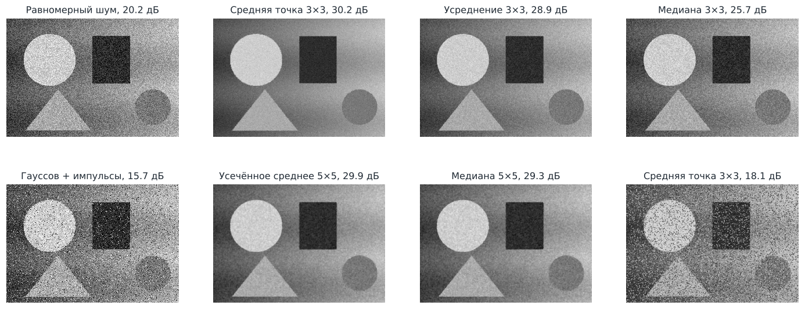

Равномерный шум ±43: в окне 3×3 средняя точка даёт 30,2 дБ — больше, чем усреднение (28,9) и медиана (25,7).
Смешанный шум: в окне 5×5 усечённое среднее (отброшено по 25% с каждой стороны) — 29,9 дБ, медиана — 29,3,
средняя точка — 16,5: импульсы её ломают.

### 11. Top-Hat: частицы на неоднородном фоне

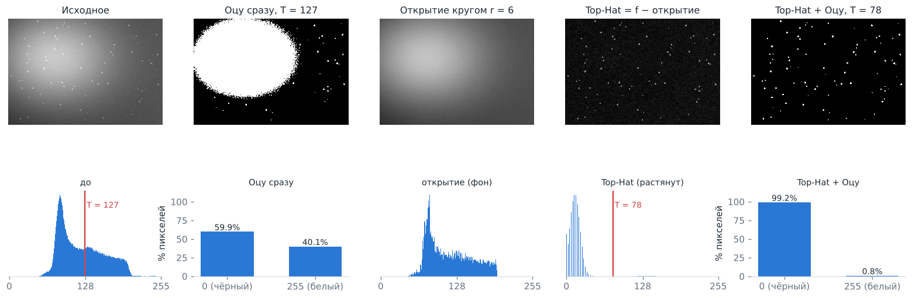

Яркость фона меняется примерно от 45 до 195, частицы светлее фона только на 45. Оцу на исходном изображении
выделяет не частицы, а светлое пятно фона (T = 127, 40% белого). Открытие кругом r = 6 удаляет все частицы
(они меньше элемента) и оставляет фон. Top-Hat = f − открытие — фон становится ровным нулём, на гистограмме
одна узкая полоса у нуля и частицы справа. Оцу на Top-Hat (T = 78) находит частицы — 0,8% белого.

### 12. Медиана перед порогом

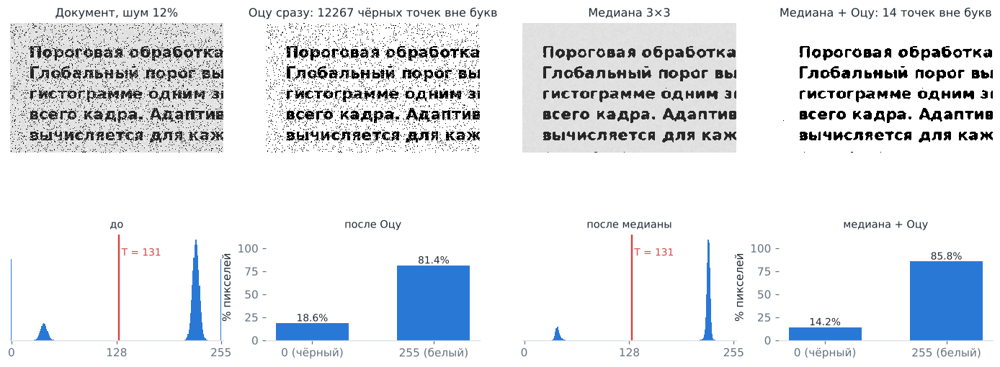

На гистограмме зашумлённого документа два пика (текст и бумага) и импульсы на краях. Порог Оцу одинаковый
(T = 131) в обоих случаях, но без фильтрации каждый импульс «перец» на бумаге становится чёрной точкой:
12 267 точек вне букв. После медианы 3×3 — 14. Ошибки на контурах букв (≈2 200 пикселей) в обоих случаях
одинаковы: это сглаживание углов букв медианой и шум на самих контурах.

### 13. Обработка краёв изображения

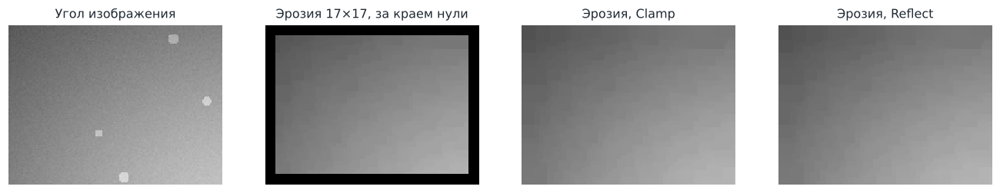

Если считать пиксели за границей нулями, эрозия окном 17×17 даёт чёрную рамку шириной 8 пикселей:
минимум окна у края всегда 0. Clamp и Reflect продолжают изображение его собственными значениями — рамки нет.
Для медианы и максимума нулевое дополнение даёт такие же артефакты у края.

### 14. Быстродействие

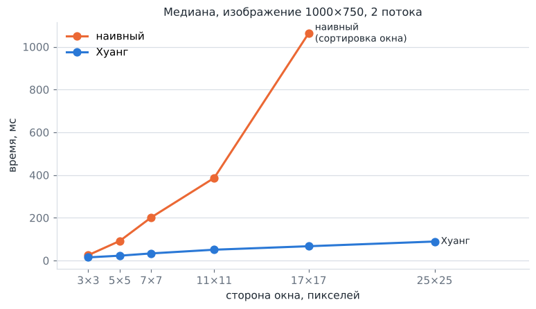

Медиана на изображении 1000 × 750, 2 потока:

| Окно | Наивный (сортировка) | Хуанг | Выигрыш |
|---|---|---|---|
| 3 × 3 | 25 мс | 15 мс | 1,7× |
| 5 × 5 | 92 мс | 23 мс | 4,0× |
| 7 × 7 | 202 мс | 33 мс | 6,0× |
| 11 × 11 | 387 мс | 51 мс | 7,6× |
| 17 × 17 | 1063 мс | 67 мс | 16× |
| 25 × 25 | — | 89 мс | |

Время наивного алгоритма растёт как площадь окна, у Хуанга — как его сторона.

Изображение 4000 × 3000 (12 млн пикселей), машина с 2 ядрами:

| Операция | 1 поток | 2 потока |
|---|---|---|
| Медиана 5×5, Хуанг | 732 мс | 383 мс |
| Адаптивная медиана, Smax = 7×7 | 4806 мс | 2233 мс |
| Морфологический градиент, круг r = 3 | 2139 мс | 1040 мс |
| Саувола, окно 51×51 | 450 мс | 262 мс |
| Гаусс σ = 5, разделяемый | 1417 мс | 644 мс |

Разделяемая свёртка против полной двумерной (2 потока):

| Ядро Гаусса | Две 1D-свёртки | Одна 2D-свёртка | Выигрыш |
|---|---|---|---|
| 7 × 7 | 217 мс | 611 мс | 2,8× |
| 19 × 19 | 438 мс | 2039 мс | 4,7× |
| 31 × 31 | 775 мс | 4835 мс | 6,2× |

## Соответствие дополнениям для группы 10А

| Требование | Где |
|---|---|
| Пиксельный доступ без GetPixel/SetPixel | `buffer.FxImages` (блочное копирование), все алгоритмы — циклы по `int[]` / `double[]` |
| Обработка краёв Clamp и Reflect | `buffer.EdgeMode`, выбор в интерфейсе |
| Разделяемая свёртка | `Convolution.separable`, `LinearFilter` (усреднение и Гаусс) |
| Оцу с межклассовой дисперсией | `GlobalThreshold.otsu` |
| Интегральное изображение для адаптивного порога | `IntegralImage`, `AdaptiveThreshold` |
| Сложные морфологические операции: градиент, Top-Hat, Black-Hat | `Morphology` |
| Многопоточная обработка | `Parallel.rows` |
| Отчёт с гистограммами до/после | этот файл, раздел «Отчёт» |
| Слои UI / Memory / Processing | пакеты `ui`, `buffer`, `processing` |
| Дополнительная оптимизация порядковых фильтров | `OrderFilter.huang` — скользящая гистограмма |
