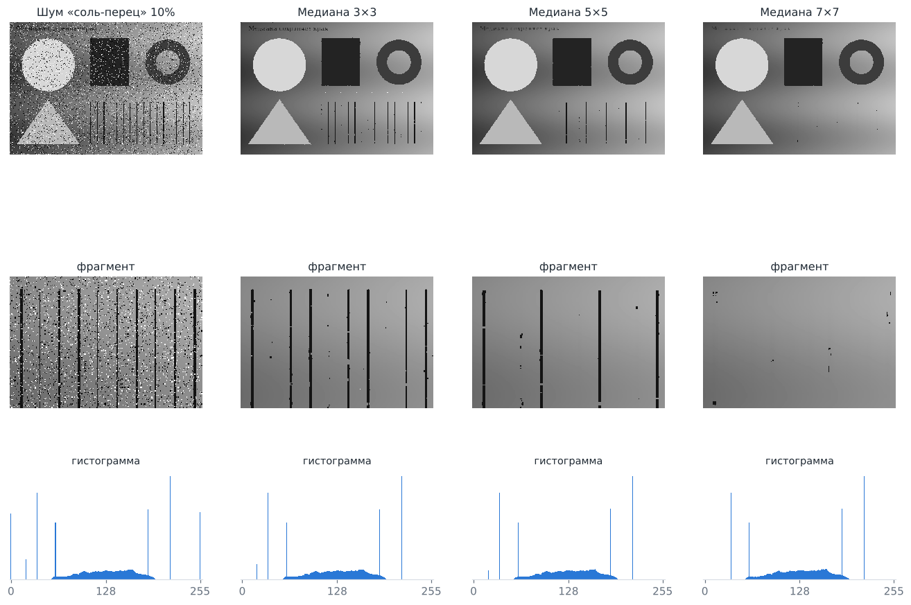
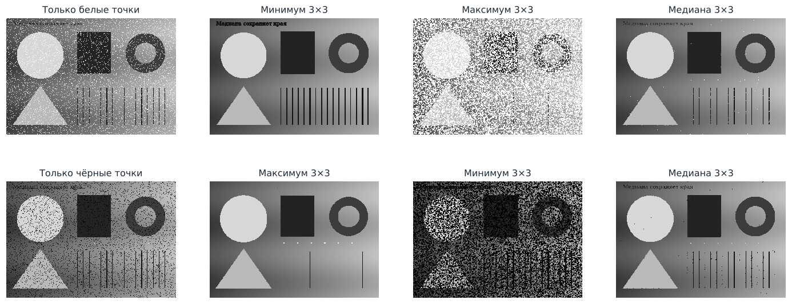
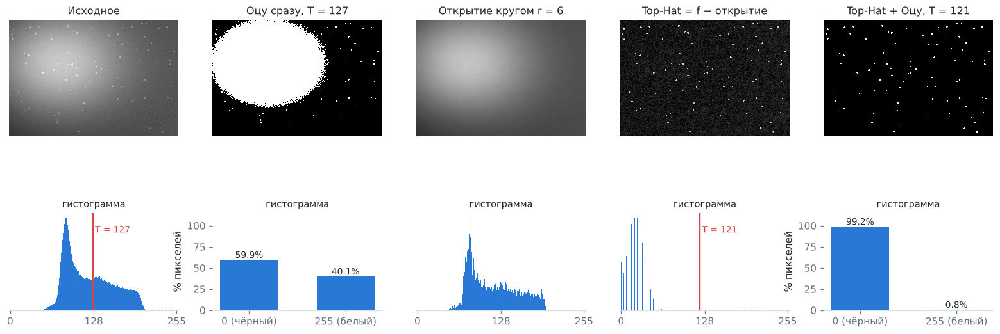
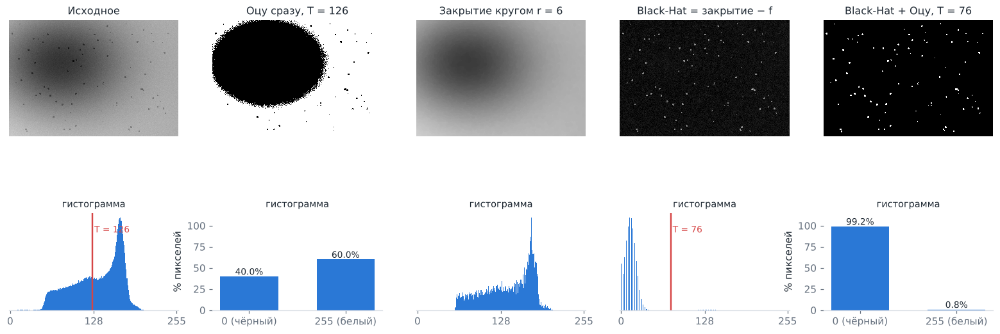
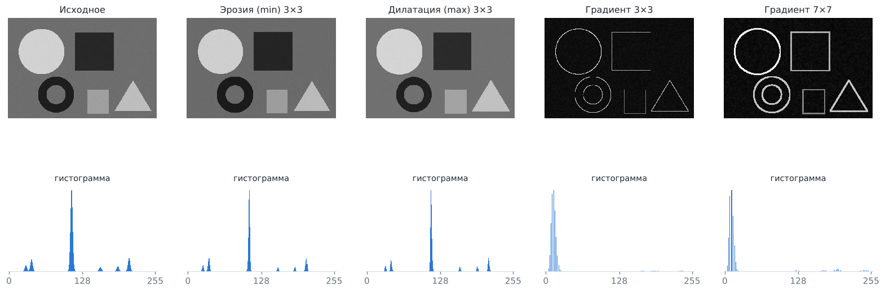
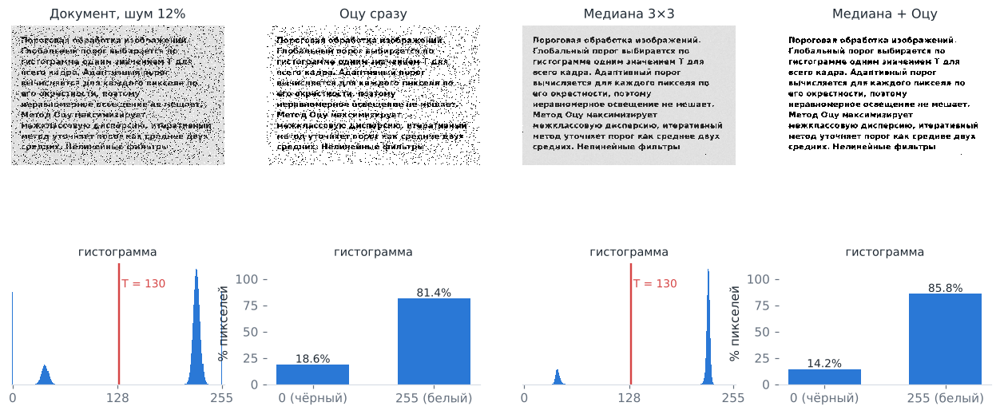
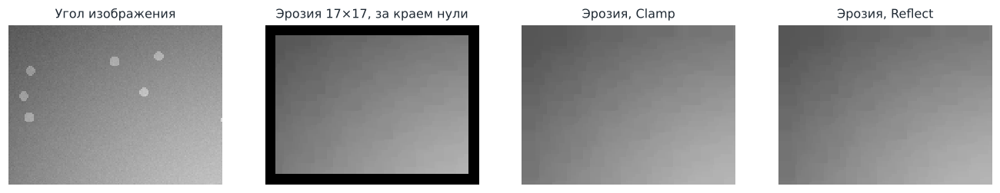

# Лабораторная работа 3 — пороговая обработка и нелинейные фильтры

**Вариант 10:** глобальная пороговая обработка (2 метода) + адаптивная пороговая обработка;
нелинейные фильтры, основанные на порядковых статистиках. Выполнено с дополнениями для группы 10А.

## Запуск

```bash
./gradlew :lab3-image-processing:run
./gradlew :lab3-image-processing:test
```

Windows-установщик `ImageProcessing.exe` собирает GitHub Actions (workflow **Build Windows EXE**).
Тестовые изображения встроены в программу — список «Тестовые изображения» в верхней панели.

## Методы

| № | Метод | Что делает |
|---|---|---|
| 1 | Итеративный порог | глобальный порог T = (m₁ + m₂)/2, повтор до сходимости |
| 2 | Метод Оцу | глобальный порог с максимальной межклассовой дисперсией |
| 3 | Саувола | адаптивный порог через интегральное изображение |
| 4 | Медиана | средний элемент отсортированного окна |
| 5 | Минимум | наименьший элемент окна (эрозия) |
| 6 | Максимум | наибольший элемент окна (дилатация) |
| 7 | Морфология | градиент, Top-Hat, Black-Hat на основе минимума и максимума |

Общие настройки: обработка краёв **Clamp / Reflect**, форма окна (квадрат, круг), радиус окна,
«затем бинаризовать порогом Оцу» для фильтров, число потоков.

## Архитектура

| Слой | Классы | Ответственность |
|---|---|---|
| Presentation (UI) | `MainApp`, `ui.ControlsPane`, `ui.HistogramView` | картинки «до» и «после», гистограммы, слайдеры, прогресс |
| Memory & Pixel Access | `buffer.GrayImage`, `buffer.EdgeMode`, `buffer.FxImages`, `buffer.BmpWriter` | изображение как массив `int[]`, доступ `get(x, y, EdgeMode)` с обработкой краёв |
| Processing | `processing.*` | алгоритмы: «буфер → новый буфер», ничего не знают об интерфейсе |

| Класс | Что делает |
|---|---|
| `Histogram`, `GlobalThreshold` | гистограмма, итеративный порог, Оцу, бинаризация |
| `IntegralImage`, `AdaptiveThreshold` | интегральные изображения, метод Сауволы |
| `WindowShape`, `OrderFilter` | форма окна; медиана, минимум, максимум |
| `Morphology` | эрозия, дилатация, открытие, закрытие, градиент, Top-Hat, Black-Hat |
| `Parallel`, `Progress` | многопоточность по полосам строк, прогресс и отмена |

**Доступ к пикселям.** Картинка один раз копируется из JavaFX `Image` в массив целиком
(`PixelReader.getPixels` — аналог `LockBits`) и обратно (`PixelWriter.setPixels`). Все алгоритмы —
вложенные циклы по массиву. Перевод в серый: Y = 0,299R + 0,587G + 0,114B.

**Обработка краёв** (`EdgeMode`): Clamp — повтор граничного пикселя `a a | a b c | c c`;
Reflect — зеркальное отражение `c b | a b c | b a`.

**Многопоточность** (`Parallel`): строки делятся на полосы, потоки забирают полосы по очереди.
Каждый пиксель результата пишет ровно один поток, синхронизация не нужна.

## Формулы

**Итеративный порог.** T₀ — средняя яркость; пиксели делятся на > T и ≤ T, m₁ и m₂ — их средние;
T = (m₁ + m₂)/2; повторять, пока |ΔT| ≥ 0,5.

**Оцу.** Для каждого k = 0…255: ω(k) = Σᵢ₌₀ᵏ pᵢ, μ(k) = Σᵢ₌₀ᵏ i·pᵢ,
**σ²_B(k) = (μ_T·ω(k) − μ(k))² / (ω(k)·(1 − ω(k)))**. Порог — k с максимальной σ²_B.
Разделимость η = σ²_B / σ²_G ∈ [0, 1].

**Саувола.** T(x, y) = m · (1 + k·(s/R − 1)), R = 128; m — среднее, s — СКО в окне.
m и s берутся из интегральных изображений сумм и сумм квадратов: сумма окна = S(D) − S(B) − S(C) + S(A),
O(1) на пиксель при любом размере окна.

**Порядковые фильтры.** Значения окна сортируются: g₍₀₎ ≤ … ≤ g₍ₙ₋₁₎.
Медиана — g₍ₙ/₂₎, минимум — g₍₀₎, максимум — g₍ₙ₋₁₎.

**Морфология.** Эрозия f ⊖ B = минимум, дилатация f ⊕ B = максимум по окну B.
Открытие = (f ⊖ B) ⊕ B, закрытие = (f ⊕ B) ⊖ B.

| Операция | Формула | Что выделяет |
|---|---|---|
| Градиент | (f ⊕ B) − (f ⊖ B) | контуры |
| Top-Hat | f − открытие | мелкие светлые детали на неоднородном фоне |
| Black-Hat | закрытие − f | мелкие тёмные детали на неоднородном фоне |

## Тестовые изображения

| № | Изображение | Метод | Что показывает |
|---|---|---|---|
| 1 | Монеты на светлом фоне | Оцу | два пика — оба глобальных метода работают |
| 2 | Текст на бумаге двух оттенков | Оцу | Оцу лучше итеративного |
| 3 | Деталь с наклейками | итеративный | итеративный лучше Оцу |
| 4 | Текст при неравномерном освещении | Саувола | справляется только адаптивный |
| 5 | Документ с тенью | Саувола | справляется только адаптивный |
| 6 | Шум «соль-перец» 10% | медиана | шум убран, края резкие |
| 7 | Только белые точки | минимум | минимум убирает «соль» |
| 8 | Только чёрные точки | максимум | максимум убирает «перец» |
| 9 | Светлые частицы на неоднородном фоне | Top-Hat | частицы отделены от фона |
| 10 | Тёмные пятна на неоднородном фоне | Black-Hat | пятна отделены от фона |
| 11 | Фигуры | градиент | контуры |
| 12 | Документ с шумом | медиана + Оцу | фильтр перед порогом |
| 13 | 4000 × 3000 | медиана | скорость, многопоточность |

Генератор изображений — `docs/make_samples.py`.

## Отчёт: сравнение «до» и «после»

### 1. Два пика — оба глобальных метода работают


Итеративный (137) и Оцу (135) попадают в «долину» между пиками, η = 0,97.

### 2. Оцу лучше итеративного


Три пика: текст (45), тень (190), светлая бумага (245). Итеративный стартует со среднего ≈ 207 и сходится
к T = 205 — делит лист пополам (55% чёрного). Оцу выбирает глобальный максимум σ²_B: T = 115, только текст (9%).

### 3. Итеративный лучше Оцу


Нужно отделить деталь (92) от стола (14). Итеративный от среднего ≈ 69 находит T = 65.
У Оцу максимум σ²_B — на разбиении «наклейки | остальное» (T = 140), деталь теряется.

### 4–5. Адаптивный порог


На гистограмме нет «долины» между текстом и фоном. Глобальный порог заливает тёмную часть
(46–60% чёрного). Саувола сравнивает пиксель с окрестностью: 9–10% чёрного — это текст.

### 6. Медиана



Импульсы — пики гистограммы на 0 и 255. Медиана 3×3 их убирает, края фигур остаются резкими.
С ростом окна шум уходит тот же, но тонкие линии исчезают: в окне 7×7 линия шириной 1–3 пикселя
занимает меньше половины окна и медиана её «не видит».

### 7. Минимум и максимум



Белая точка — наибольшее значение окна, минимум её отбрасывает; чёрная — наименьшее, её отбрасывает максимум.
Плата: минимум расширяет тёмные объекты, максимум — светлые. Фильтр «не того» вида раздувает каждую точку в квадрат 3×3.

### 8. Top-Hat



Фон меняется от 45 до 195, частицы светлее фона только на 45. Оцу на исходном выделяет светлое пятно фона
(T = 127). Открытие кругом r = 6 убирает частицы и оставляет фон; Top-Hat = f − открытие — ровный ноль и частицы.
Оцу после Top-Hat находит только частицы (0,8% белого).

### 9. Black-Hat



Зеркальный случай: закрытие закрашивает тёмные пятна, Black-Hat = закрытие − f оставляет только их.
Оцу на исходном захватывает тёмную область фона (40% чёрного), после Black-Hat — только пятна.

### 10. Морфологический градиент



Внутри однородной области max = min и градиент равен нулю, на границе — перепад яркости.
Толщина контура растёт с размером окна.

### 11. Медиана перед порогом



Порог Оцу одинаковый (T = 130), но без фильтра каждый импульс становится точкой результата.
После медианы 3×3 текст чистый.

### 12. Обработка краёв



Если считать пиксели за границей нулями, эрозия 17×17 даёт чёрную рамку шириной 8 пикселей.
Clamp и Reflect продолжают изображение его собственными значениями — рамки нет.

### 13. Быстродействие

Изображение 4000 × 3000 (12 млн пикселей), машина с 2 ядрами:

| Операция | 1 поток | 2 потока |
|---|---|---|
| Медиана 3×3 | 614 мс | 304 мс |
| Медиана 5×5 | 2386 мс | 1279 мс |
| Минимум 5×5 | 707 мс | 417 мс |
| Top-Hat, круг r = 3 | 2135 мс | 1137 мс |
| Саувола, окно 31×31 | 523 мс | 339 мс |

Время Сауволы не зависит от размера окна благодаря интегральному изображению.

## Соответствие дополнениям для группы 10А

| Требование | Где |
|---|---|
| Пиксельный доступ без GetPixel/SetPixel | `buffer.FxImages`, все алгоритмы — циклы по `int[]` |
| Обработка краёв Clamp и Reflect | `buffer.EdgeMode` |
| Оцу с межклассовой дисперсией | `GlobalThreshold.otsu` |
| Интегральное изображение для адаптивного порога | `IntegralImage`, `AdaptiveThreshold.sauvola` |
| Морфологический градиент, Top-Hat, Black-Hat | `Morphology` |
| Многопоточная обработка | `Parallel.rows` |
| Отчёт с гистограммами до/после | этот файл |
| Слои UI / Memory / Processing | пакеты `ui`, `buffer`, `processing` |
